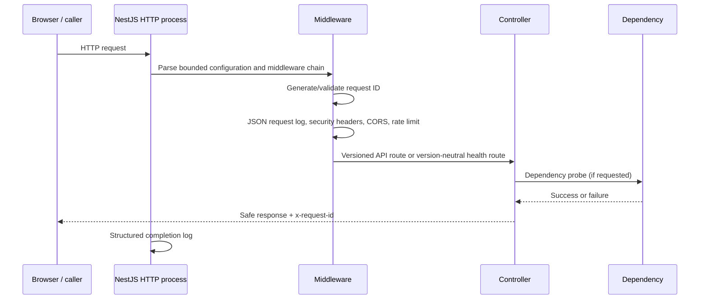
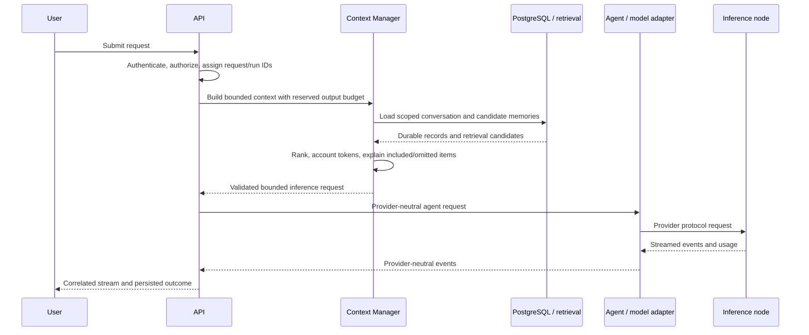

# Request Lifecycle

## Phase 1 HTTP lifecycle

The exact Express/Nest internal ordering is defined in `apps/api/src/main.ts`; the diagram describes the intended logical stages, not every framework callback. Body parsing is bounded to 64 KiB. CORS restricts browser origins but does not authenticate callers.

## Phase 1 health semantics

`/health` answers whether this process can handle HTTP. Database, Redis, and inference checks contact their dependency and report readiness independently. A database outage should not make the liveness probe fail and cause an orchestrator restart loop; it should make the database readiness probe fail. These endpoint checks are simple synchronous probes and currently have no circuit breaker or cache.

The request ID correlates the caller's response, request completion log, and sanitized exception body. An invalid incoming ID is replaced. The ID does not prove caller identity and must not become an authorization token.

## Target inference lifecycle (not implemented yet)

This is a future target. Phase 1 does not implement inference, conversations, authentication, context budgeting, or streaming. Each future stage must define cancellation, partial result persistence, retry behavior, token accounting source, timeout budget, and failure response before being considered reliable.

## Interview prompts

- Why separate liveness from dependency readiness?
- How should request IDs propagate into queue jobs and streaming events?
- Where should an inference timeout budget be spent: queue wait, prompt processing, generation, or all three?
- Which failures are safe to retry after a client disconnect, and how does idempotency affect that answer?
