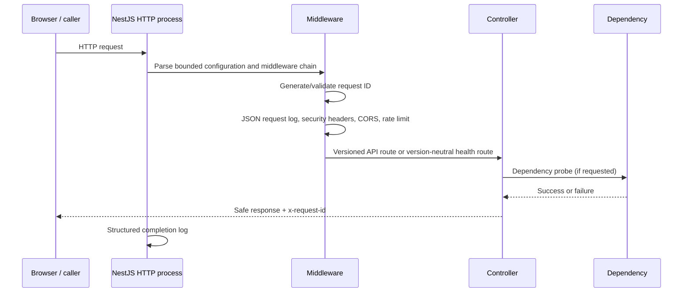
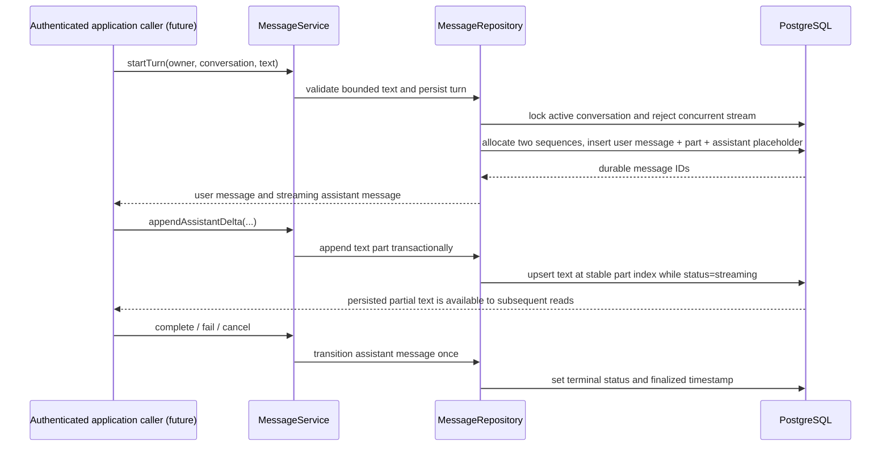
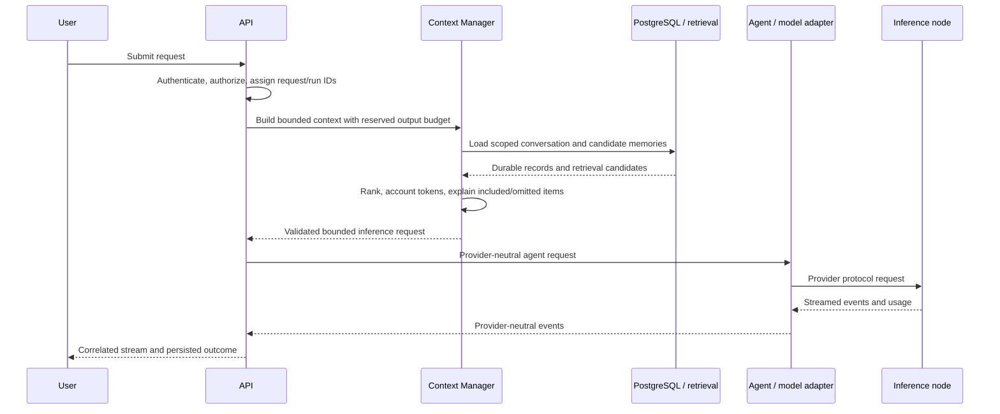

# Request Lifecycle

## Phase 1 HTTP lifecycle

The exact Express/Nest internal ordering is defined in `apps/api/src/main.ts`; the diagram describes the intended logical stages, not every framework callback. Body parsing is bounded to 64 KiB. CORS restricts browser origins but does not authenticate callers.

## Phase 1 health semantics

`/health` answers whether this process can handle HTTP. Database, Redis, and inference checks contact their dependency and report readiness independently. A database outage should not make the liveness probe fail and cause an orchestrator restart loop; it should make the database readiness probe fail. These endpoint checks are simple synchronous probes and currently have no circuit breaker or cache.

The request ID correlates the caller's response, request completion log, and sanitized exception body. An invalid incoming ID is replaced. The ID does not prove caller identity and must not become an authorization token.

## Phase 3 conversation persistence lifecycle

`ConversationService` and `MessageService` are exported from the conversation module for trusted application callers. Every operation takes the trusted owner ID explicitly and includes it in repository predicates. There is not yet a conversation HTTP controller because authentication has not established a trusted owner identity.

The application caller may later connect a provider stream to these persistence methods. This phase does not call a model or send events to a browser. Cancellation here finalizes durable state; propagating an abort signal to an inference provider belongs to the inference/streaming phases.

Retry creates a new streaming assistant message only from a failed or cancelled response. Regeneration creates one from a completed response. Both point to the original user message and increment its serialized generation attempt. Branching copies messages and parts up to a terminal fork point into a new conversation while retaining the parent/fork pointers; it rejects unfinished output in the copied range. Archived conversations remain readable/renameable but cannot accept new turns.

## Target inference lifecycle (not implemented yet)

This is a future target. Phase 3 provides durable conversation messages and lifecycle operations, but does not implement authentication, context budgeting, provider inference, or client streaming. Future stages must define provider cancellation, token accounting source, timeout budget, and response delivery behavior before the complete inference workflow is considered reliable.

## Interview prompts

- Why separate liveness from dependency readiness?
- How should request IDs propagate into queue jobs and streaming events?
- Where should an inference timeout budget be spent: queue wait, prompt processing, generation, or all three?
- Which failures are safe to retry after a client disconnect, and how does idempotency affect that answer?
