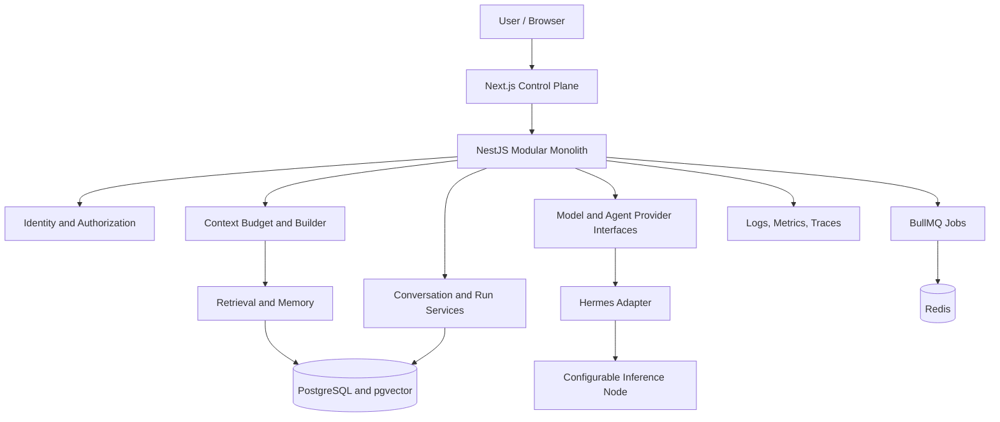

# System Overview

## Purpose

This project is a private AI infrastructure and memory platform. Its primary engineering challenge is to select and manage the context supplied to an agent, not to replay an ever-growing transcript to a model. The control surface should make orchestration, context choices, costs, and failures inspectable.

## Intended request path

This is a target architecture, not a claim that these components exist. The initial implementation should remain a modular monolith. The inference node is independently configurable and may run locally or on a private network.

## State and context model

| Concept | Role | Expected lifetime |
| --- | --- | --- |
| Conversation history | Durable sequence of user, assistant, and tool events | Conversation retention policy |
| Persistent memory | Curated facts, preferences, decisions, and project knowledge | Explicit lifecycle and deletion policy |
| Retrieved context | Request-specific subset selected for relevance and scope | One inference/run, with provenance |
| Inference context | Fully assembled prompt and tool definitions sent to a specific model | One provider request; bounded by that model's active limit |

Memory is not a transcript archive. Retrieval is not guaranteed to be relevant. The context builder must account for system instructions, request, retrieved material, recent conversation, tool definitions, and reserved output before dispatch. Estimates and provider-reported token counts must remain distinguishable.

## Boundaries

- The web app is an authenticated control plane and does not call a private inference node directly.
- The API owns authorization, persistence coordination, context policy, provider selection, and request correlation.
- Agent and model vendors are isolated behind internal interfaces and adapters.
- PostgreSQL owns durable state. Redis and queue state are treated as operational state with explicit recovery semantics.
- Tools are privileged capabilities, independently authorized and bounded by schema, timeout, and resource policy.

## Decisions and open questions

The modular monolith is the starting boundary because the product is early and its data and workflows are closely coupled. Service extraction would add network failure and operational cost before a scaling or team boundary is established. PostgreSQL, raw `pg`, Redis, and the pgvector extension are accepted foundation choices with their current scope and limitations recorded in ADRs. Queue semantics, streaming transport, Hermes, and MLX still require later decisions against verified requirements and failure behavior.

Open design work includes identity model, tenant/project isolation, context token accounting accuracy, memory provenance and retention, provider cancellation semantics, queue idempotency, and deployment network topology. Do not present these as settled decisions until their ADRs and implementation evidence exist.

## Failure posture

Every dependency can be unavailable or slow. Readiness must report dependency state separately from process liveness. Inference should fail with a correlated, classified error; retrieval may have a documented degraded mode only if security and product semantics allow it. Queued work must be idempotent where possible and safe to retry. Streaming disconnects and partial outputs must be persisted and represented explicitly.

## Staff-level review prompts

- Which state is authoritative, and which state can be rebuilt?
- What consistency does a user observe when a stream disconnects midway?
- How is a context budget enforced when token counting is approximate?
- What is the first bottleneck: prompt processing, model memory, database access, or queueing, and what evidence distinguishes them?
- At what measured load or ownership boundary would a module become a separate service?
- What private data could leak through retrieval, logs, tools, or cross-project queries?
