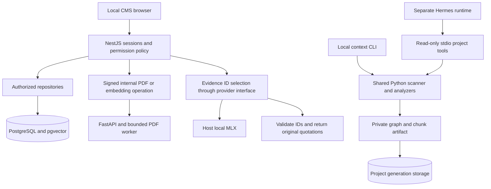

# Architecture and implementation boundaries

Updated 2026-11-09 from the owning source. This page is the current architecture, not the superseded laboratory roadmap. Historical observations live in the [journal](../engineering-journal.md); design rationale lives in the [decision register](../decisions/README.md).

## Two paths, different guarantees

| Path | Implemented | Still missing |
| --- | --- | --- |
| Company PDF assistant | Local accounts/sessions, four roles, employee PDF ownership, bounded extraction, local embeddings, authorized lexical/vector retrieval, exact evidence citations, cache/routing/run metadata | Live Google acceptance, OCR, bulk import, automatic policy applicability, production hardening, full tracing and real-company evaluations |
| Project-context platform | Local scanner/analyzers/graph; durable immutable generations; local lexical/graph retrieval; separate read-only Hermes tools | Authenticated project membership/source ACLs, project semantic retrieval, deterministic reusable compiler, Atlas acceptance and shared agent integration |

Legacy single-owner general chat and pasted-reference routes are disabled by default. Their PostgreSQL conversations remain stored; they are not CMS account histories. No path automatically synchronizes with Hermes memory.

The diagram does not imply browser integration with the project graph or Hermes. Company retrieval queries run in Nest-owned repositories. Python computes PDF text/vectors; it does not decide employee business permissions.

## Service boundaries

| Owner | Responsibility | Reason and cost |
| --- | --- | --- |
| NestJS | Authentication, RBAC/object policy, HTTP APIs, orchestration, transactions, audit, retrieval/cache | One business policy owner; API/database availability becomes part of request availability |
| FastAPI/shared Python | PDF parsing/embeddings and local project analysis | Reuse Python libraries; pay HTTP, credential, deadline and versioned-contract costs |
| PostgreSQL | Durable records, constraints, transactions, vectors and derived policy cache | One operational store; pool/query contention is shared |
| MLX adapter | Translate application completion/model-list contracts to the local provider | Mac-specific runtime stays replaceable; protocol compatibility still needs testing |
| Web | Upload/classification, account/record workflows and citation inspection | User convenience; hiding a control never establishes access |
| Hermes MCP | Three bounded local project-read tools | Narrower than shell access; no per-user authorization and no CMS business tools |

Controllers validate transport and map errors. Application services own use-case rules and transactions. Repositories own parameterized SQL. Adapters contain vendor behavior. Do not create one microservice per capability: split only for measured isolation, scaling or ownership pressure.

## Company request flows

### Publish a PDF

`PeopleSessionGuard` → admin upload guard → `PolicyRagService.uploadPdf` → `PolicyComputeClient` → FastAPI → isolated extraction → BGE embeddings → repository transaction.

The request carries a file and deliberate classification. Nest signs exact computation request bytes with HMAC, binds organization/user/operation and checks freshness within 60 seconds in Python, alongside the service bearer. This proves the trusted service sent those bytes; it is not independent customer authentication, does not protect against a compromised service, and is not a single-use/replay ledger.

After computation, Nest locks/rechecks the admin account. One transaction writes the document/passages/vectors, audit/run records and organization revision. Identical active bytes + audience + model profile + owner + category return the existing document ID under an advisory lock and unique index. Duplicate upload can still repeat extraction/embedding before deduplication. Changed bytes create a new document; superseded policy archival is explicit.

PDF limits: 5 MiB, 100 pages, 160,000 extracted characters, 200 passages, roughly 1,000 characters per passage. The Linux worker has CPU/memory/parent deadlines; the container limits aggregate resources. Scans, encrypted/active/embedded/form PDFs and unsupported inputs fail rather than falling back to guessed text. These checks are not a general malware scanner. Original PDF bytes are transient, but extracted text/vectors persist.

### Answer from uploaded documents

`PeopleController.assistant` → `PeopleService.ask` → `PolicyRagService.ask` → authenticated active account/revision → local query embedding → available-model routing → scoped cache lookup or authorized hybrid retrieval → evidence ID selector → recheck access/revision/session → original quotations.

The vector query materializes the authorized active organization/role/owner/profile subset before exact distance ranking. Lexical SQL uses the same permission predicate. Reciprocal-rank fusion combines ranks; at most eight candidates/3,500 UTF-8 bytes enter the selector, which may choose up to three known IDs. The server maps them back to exact stored text and PDF page/extracted-line references. Arbitrary model prose and forged IDs are rejected. An empty relevant selection is not-found; a dependency error is an error.

**Important targeting limit:** uploaded-PDF questions search all documents the caller may read. The employee selector affects structured salary/leave lookups; it does not currently narrow PDF retrieval to that employee. HR/accountants must verify the owner in each citation. The model can choose the wrong permitted employee's source; per-target retrieval and applicability checks are future work.

### Read or change live records

Structured `salary`/`leave` topics authorize the selected employee and period, then read authoritative CMS tables. PDF text does not become a financial transaction. Pending leave reserves calendar days; account-row locking prevents concurrent requests overspending the same entitlement. HR/admin can decide others' requests, not their own. There is no holiday calendar, accrual engine, tax computation, HRMS synchronization or automatic PDF numeric import.

## Identity and authorization

| Role | Salary records/PDFs | Leave records/PDFs | Administration |
| --- | --- | --- | --- |
| user | Own read | Own read/request | None |
| hr | All read | All read; decide others' requests | None |
| accountant | All salary read; structured payroll write | Own read/request | None |
| admin | All read/write | All read/manage; no self-approval | Accounts, roles, documents and audits |

Company policy audiences are separate: `all`, `hr`, `accountant`, `admin`; admins may read all. Personal PDFs require a real employee in the same organization and private audience, with owner/category SQL policy. Classifying a mixed or multi-employee PDF incorrectly can disclose its text. The app does not reliably infer these boundaries from content.

Local passwords use unique salts and scrypt N=32768/r=8/p=3. Random session tokens are stored hashed in PostgreSQL and expire after eight hours. Password/role/deactivation changes revoke sessions; guards resolve current role/status. Five failed logins lock an account for 15 minutes, plus per-process HTTP limits. First-admin setup is serialized and requires a trusted local operator.

Google Workspace is prepared through OAuth Authorization Code/PKCE and OIDC, with browser-bound expiring state/nonce and validated RS256 issuer/audience/expiry/signature. Exact `(issuer, sub)` bindings map to local active accounts. A signed `hd` must match the configured Workspace domain. Neither email suffix nor token role creates privileges. Registered organization configuration and live provider acceptance are still missing.

The CMS cookie is HttpOnly, SameSite Strict, HTTP-local and scoped to `/api/v1/cms`; the OIDC attempt cookie has separate callback semantics. These are local pilot settings, not a production HTTPS design. Exact browser Origin checks supplement sessions; local processes can forge Origin. Production routes remain denied. Shared Docker peers have reachability even when published host ports bind to loopback.

## Data ownership and consistency

| Store | Authority and lifecycle |
| --- | --- |
| `people_cms.organizations/accounts/sessions` | One local organization, current roles/status and session revocation; not multi-tenant SaaS membership |
| `people_cms.payroll/leave_accounts/leave_requests` | Explicit employee records and transactional workflow state |
| `people_cms.documents/document_passages` | Extracted evidence, ownership/category, page/line references, active status and embedding profile |
| `people_cms.policy_cache` | Replaceable source-ID selections/query vectors; scoped to account/role/org/revision/model/profile; five-minute TTL |
| `people_cms.policy_runs/audit_events` | Measured metadata and business decisions, not source text or complete distributed spans |
| `context_platform.*` | Separate immutable project generations, sources/nodes/edges/chunks/checkpoints/heads |
| Legacy public conversation tables | Stored single-owner transcript lifecycle; historical browser path disabled by default |
| Hermes SQLite/files | Separate runtime history/curated memory, not copied from the CMS |

Migrations `0001`–`0005` preserve legacy data; `0006`–`0008` add project storage; `0009`–`0011` add CMS/PDF ownership. One checksum-verified raw-pg runner owns schema changes. Do not rewrite applied files. The historical `0006` checksum compatibility entry is narrowly explicit; it is not permission to silently accept arbitrary drift.

Project storage uses `context_runtime`, transaction-local scope, RLS and composite FKs. The CMS instead uses explicit organization/object SQL predicates under its configured database role; non-owner CMS RLS is not implemented. Database owner access is trusted. A UUID identifies an object; it does not establish user membership.

Short database transactions protect local invariants. Inference/extraction occurs outside their locks. A timeout can leave an uncertain commit outcome; check durable state before repeating side effects. PostgreSQL cannot atomically commit a remote Jira/Slack write. No such connector/outbox is implemented here.

## API contracts: implemented versus proposed

Implemented company routes under `/api/v1/cms` include setup/login/session/logout, account management, employee records, payroll/leave workflows, document listing/archive/upload, assistant questions, admin run metrics and optional OIDC. Read the actual transport handlers for body shapes: [people HTTP](../../apps/api/src/people/people.http.ts), [PDF HTTP](../../apps/api/src/people/policy-rag.http.ts), [OIDC HTTP](../../apps/api/src/people/oidc.http.ts). Multipart upload accepts `file`, `audience`, `recordKind` and optional `employeeId`; filename supplies title. Never send role/organization as permission grants.

Python exposes authenticated `/internal/health` and signed `/internal/policy/compute`; public `/health` is process liveness. CMS error meanings include 400 invalid input, 401 missing/revoked session, 403 denied operation, 409 changed policy/conflict, 413 upload size, 422 unsupported PDF, 429 busy/limited, 502 invalid upstream selection/schema and 503 unavailable dependency. Do not assume every endpoint has an identical envelope; inspect its controller.

Project `/projects/:id/context/search|compile`, scan job/status/cancel APIs, reusable SDK and `AgentContextProvider` are **proposed**, not shipped routes. Their required contract is Nest-derived tenant/user/project/environment/source permissions, bounded request/results, pinned generation, provenance, safe errors and request correlation. No unscoped `search(query)` service should be exposed.

## Threat model and remaining risks

| Threat | Present defense | Residual risk / deployment gate |
| --- | --- | --- |
| Another employee requests private pay | Session identity and owner/role predicates before candidates/cache sources | Incorrect classification; privileged HR chooses irrelevant permitted employee |
| Malicious PDF instructions | Inert evidence, no tools, valid-ID selection and server quotations | Selection poisoning or malicious source wording can still be quoted |
| Resource exhaustion | File/text/chunk limits, Linux extraction caps and one active computation | Busy responses, unmeasured fairness and API concurrency pressure |
| Credential disclosure | Heuristic scan before embeddings/storage; safe application logs | Unknown formats/PII missed; backups/derived vectors remain sensitive |
| Stale or revoked evidence | Active-source reload, revision/account/session checks | Final-check-to-delivery race; delivered text cannot be recalled |
| Service impersonation/SSRF | Configured destinations, redirect denial, bearer/HMAC for compute | Compromised trusted service/host; no complete network egress policy |
| Retention failure | Originals not retained; archive removes future access | Archive is not erasure; no automated deletion across text/vectors/cache/backups |

Local inference reduces external transfer but does not encrypt disks, protect against malicious local operators or configure every Hermes tool. No universal prompt-injection/PII/security guarantee is claimed. Before real company exposure, establish HTTPS/private networking, least-privilege roles, retention/restore, MFA/recovery, classification governance, live SSO and representative acceptance tests.

## Budget, caches and observability

Embeddings use local `BAAI/bge-small-en-v1.5` through FastEmbed CPU, vector dimension 384, with a model/tokenizer/library fingerprint. Equal dimensions do not imply compatible vector spaces. The tested language is English; Nepali/Hindi quality is unverified.

The final model request reserves output capacity and labels its UTF-8-byte/template estimate honestly. This is not exact tokenizer accounting or the generic project context compiler. Exact policy cache reuses permitted source IDs, not unrestricted answer prose; selected personal PDFs are not cached. Semantic reuse is experimental/off by default. Routing uses only provider-reported models, with a heuristic small/large choice; live dual-model gains are unmeasured.

`policy_runs` records actual outcome/model/profile/cache/source count and measured retrieval/inference/total durations. Retrieval includes pre-inference preparation; cache-hit inference is null. Total currently excludes some later audit/run persistence and HTTP delivery, so it is not complete client latency. There is no reported token usage/TTFT/cost or exported full OTel trace. Unmeasured capacity remains UNKNOWN.

## Project-context roadmap

The 2026-11-03 brief remains the owning sequence for reusable project context; earlier laboratory phase labels are historical. The company PDF increment was explicitly requested later and does not close these gates.

| Phase | State / next acceptance |
| --- | --- |
| 0 Architecture | Boundaries and review documented |
| 1 Foundation | Runtime/health/internal auth and bounded failure/recovery recorded |
| 2 Scanner | Bounded screened local reads; no repository execution |
| 3 Analyzers | Static source-ranged facts; syntax does not prove runtime behavior |
| 4 Graph | Deterministic local nodes/edges/provenance and bounded traversal |
| 5 Storage | Checkpointed immutable publication, restricted-role experiments and rollback recorded |
| 6 Retrieval | Local lexical/graph baseline; project semantic search, membership/source ACLs and service acceptance remain incomplete |
| 7 Compiler | Deterministic cited reusable context packages not implemented |
| 8 Evaluation | Full project/Atlas judged acceptance not implemented; synthetic PDF component fixture is separate |
| 9 Atlas | Approved real checkout/revision and customer judgments not supplied/verified |
| 10 Agent integration | Authenticated shared Hermes/context-provider adapter and business tools deferred |

Stop for review after each approved increment. The next design change needs a problem, measurable acceptance, failure/recovery exercise, privacy boundary and a reason the simpler alternative is insufficient.
