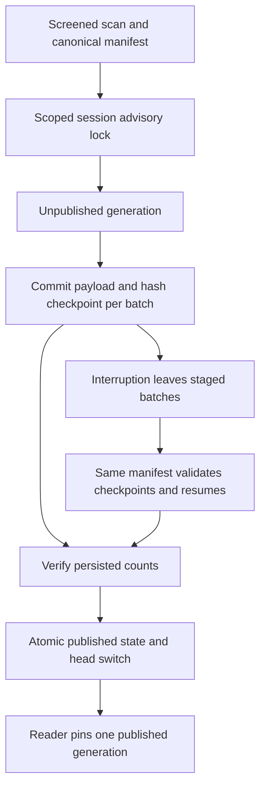

# Project scanning, graph storage and Hermes operations

This is the separate project-code workflow, not company PDF ingestion. It remains a local operator capability. The browser CMS does not query this graph, and the current Hermes bridge does not query its PostgreSQL generations. [Architecture](../architecture/system.md#project-context-roadmap) defines the remaining shared-service gates.

## Why retain this path

Code understanding needs file/symbol/schema provenance and coherent revisions, not just semantically similar prose. The scanner discovers approved files without executing them; static analyzers produce evidence; a graph connects explicit relationships; immutable publication lets later readers pin a consistent snapshot.

The cost is parser/version maintenance, private source artifacts, graph memory, storage/checkpoints and incomplete static coverage. Use it when structural/source evidence is needed. Do not add a graph database to ordinary HR policy retrieval merely because this repository already has a graph subsystem.

<a id="scanner"></a>
## Initialize and scan safely

From the platform checkout:

```sh
npm ci
cd apps/context-engine
uv sync --frozen --python 3.12
cd ../..
npm run build -w @local-ai/context-cli
npm run context -- init --root /absolute/path/to/approved-project --name my-project
npm run context -- scan --root /absolute/path/to/approved-project --output /private/tmp/my-project-scan.json
```

Use a fresh output path whose parent exists. Init refuses to overwrite `.context-platform.json`; preserving its local project UUID keeps identities stable. Output is private mode 0600, schema version 4 with graph version 1. Exit 0 means complete discovery, 1 a root/config/output failure, 2 partial work caused by failures/limits. Complete does not mean all languages were analyzed or no secret exists.

The TypeScript CLI launches the shared Python core with an argument array, not a shell executing repository scripts. `CONTEXT_ENGINE_PYTHON` is a trusted operator interpreter setting, not controlled by project config. A scan requires no FastAPI server, production database credentials, dependency installation in the scanned project or network fetch.

Scanner code reads via descriptor-relative no-follow operations and checks regular files/concurrent changes. It rejects symlinks, VCS/dependency/build output, `.env` variants, credential/key/certificate paths, special files and unsupported paths. Configurable exact-basename exclusions are data; `.gitignore` execution/interpretation is not implemented. Archives are not unpacked. ASCII-safe relative paths are the supported subset.

Whole-file secret-pattern/entropy screening precedes eligible artifacts/chunks. A finding excludes the file rather than claiming reliable inline redaction. Findings retain safe rule/location, not matched values. Accepted chunks are private, unredacted source excerpts: false negatives and false positives remain possible.

| Bound | Current local baseline | Reason / limitation |
| --- | --- | --- |
| File/read/traversal | 1 MiB file, 50 MiB accepted reads, 20k entries, depth 24, 30 seconds traversal | Bounds growth; traversal time check is cooperative, not a hard stalled-filesystem deadline |
| Source chunks | 4k characters, 300-character overlap, 20k chunks, 16 MiB total | Preserve bounded evidence; boundary loss/duplicates remain; these are not tokens |
| Static facts | 5k per file, 50k per project | Caps artifacts; coverage becomes partial rather than silently complete |
| Native parsing | Spawned worker, 2-second per-file deadline, recycle after 12 files | Contains crash/hang; no OS memory quota for the project analyzer worker |
| Graph/query | Bounded graph and artifact, traversal depth at most 4 / 200 nodes | Stops fanout; not measured large-repository capacity |

A live working tree is not an atomic Git snapshot. Use an approved fixed checkout/revision for reproducibility. Do not increase all caps to “support enterprise” without isolation, cancellation, admission and measurements.

<a id="analyzers"></a>
## What static analysis establishes

[analyzers.py](../../apps/context-engine/analyzers.py) parses the screened bytes and emits source-hashed, 1-based inclusive ranges. Grammar versions are locked, avoiding on-demand grammar downloads. Tree-sitter 0.25 was retained after a recorded 0.26 traversal crash on a real TypeScript fixture; native workers constrain failure propagation.

| Input | Established evidence | Not established |
| --- | --- | --- |
| Python/JS/TS/TSX | Declarations, imports/exports, decorators | Cross-file binding or runtime call graph |
| Nest/Express/Fastify/FastAPI/Flask patterns | Supported literal route declarations with import evidence | Dynamic route values, middleware/auth reachability or deployment |
| GraphQL | SDL and supported resolver declarations | Live resolver execution/schema completeness |
| OpenAPI JSON/YAML | Local operations/schema names and ranges | External references, remote URLs or actual service correctness |
| PostgreSQL DDL | Local table/column syntax | Executed migrations/live schema |
| Documentation/manifests | Headings and dependency declarations | Truth of prose, runtime framework activity or safe executable setup |

JSON duplicate keys and unsafe YAML aliases/duplicate keys/depth/nodes are rejected. Unsupported/malformed siblings leave explicit partial coverage; valid siblings can continue. Regex-only parsing is simpler but easily confuses comments/strings with declarations; executing builds/imports gives richer behavior at the unacceptable cost of executing untrusted input.

<a id="graph"></a>
## Inspect the local graph

```sh
npm run context -- graph find --artifact /private/tmp/my-project-scan.json --type dependency --name fastify
npm run context -- graph traverse --artifact /private/tmp/my-project-scan.json --node-id NODE_UUID --depth 2 --limit 100
```

Use the real UUID returned by lookup. UUIDv5 identities derive from project/logical source/symbol identity rather than raw line numbers. Content/coverage changes produce a new generation; provenance remains tied to its hash/ranges. Duplicate declarations use deterministic ordinals, so adding an earlier duplicate can change later IDs. Renames and unresolved dynamic relationships are not magically stable.

The graph describes extracted containment/declaration/import/dependency/table relationships. A nearby node is not automatically relevant and a route decorator is not proof of authorization. Bounded traversal, source checks and same-generation edges prevent unrestricted expansion; shared per-source access labels are still future work.

<a id="storage"></a>
## Persist, search and recover

Configure the local `DATABASE_URL` privately; confirm target/backup and use the existing migration runner. Never ask the scanner for production database credentials. Migrations `0006`–`0008` define project generations/checkpoints/chunks; later CMS migrations are separate. Applied migration SQL is immutable.

```sh
npm run db:migrate -w @local-ai/api
npm run context -- index --artifact /private/tmp/my-project-scan.json --root /absolute/path/to/approved-project --tenant-id TENANT_UUID --environment-id ENVIRONMENT_UUID --environment-name local
npm run context -- storage search --tenant-id TENANT_UUID --project-id PROJECT_UUID --environment-id ENVIRONMENT_UUID --query "ChatService" --limit 10
```

Replace placeholders with stable valid UUIDs. Project ID comes from the initialized scan; tenant/environment are operator-supplied identifiers, not authenticated membership. `--root` re-scans and compares graph/chunk identity before persisting source text, so edited artifact chunks are not trusted. Legacy graph-only artifacts can omit root; do not infer that arbitrary chunk payloads may be uploaded.

The store switches to the restricted NOLOGIN/NOBYPASSRLS `context_runtime` role and transaction-local scope, with composite FKs binding all endpoints. The local `platform` database owner can bypass RLS. This constrains storage mistakes; it does not make the CLI a multi-user authorization service.



The index lock is held by the database session across 500-row batch transactions, with a bounded 30-second acquisition wait. A process crash releases its session lock; staged committed batches remain, invisible through the published head. Final publication is atomic, not every historical batch write. A failed transaction rolls back that transaction; it does not undo earlier committed checkpoints.

Local retrieval uses a repeatable-read snapshot, explicit scope and pinned head across node/chunk/neighbor queries. It searches exact/prefix/substring graph names/attributes and full-text/literal source chunks, then up to five same-generation neighboring relations per result. It returns ordinal ranks/match types, not calibrated confidence. It explicitly labels semantic search unavailable. No head is a distinct `no_published_generation` state; database failure is not a successful empty result.

Project semantic embeddings, source-label ACLs, authenticated shared APIs and deterministic context compilation remain incomplete. Do not confuse the working CMS PDF vector path with completed project retrieval.

### Safe recovery procedures

Only in an approved disposable project/database:

```sh
# Leave one committed staging checkpoint; confirm the previous published head remains.
npm run context -- index --artifact /private/tmp/my-project-scan.json --root /absolute/path/to/approved-project --tenant-id TENANT_UUID --environment-id ENVIRONMENT_UUID --inject-interruption-after-checkpoints 1
# Resume with the same inputs and no injection flag.
npm run context -- index --artifact /private/tmp/my-project-scan.json --root /absolute/path/to/approved-project --tenant-id TENANT_UUID --environment-id ENVIRONMENT_UUID
# Repoint to an existing valid published generation; this does not erase other data.
npm run context -- storage rollback --tenant-id TENANT_UUID --project-id PROJECT_UUID --environment-id ENVIRONMENT_UUID --generation-id GENERATION_UUID
```

Predict unchanged head after interruption, checkpoint resume on repeat, and one coherent generation after publication. Inspect scope/generation/counts and recover by resume or explicit rollback. Record behavior rather than assuming it. This does not prove relevance, production load or authenticated user isolation.

`storage delete-environment` is permanent and requires exact `--confirm-environment-id`. It cascades the selected environment's generations/checkpoints/rows; use only an explicitly disposable target after review. It is not routine recovery. Retention/tombstones/audit automation remain open.

Scoped metadata inspection:

```sql
SELECT h.generation_id, g.state, g.status, g.node_count, g.edge_count
FROM context_platform.graph_heads h
JOIN context_platform.graph_generations g
  USING (tenant_id, project_id, environment_id, generation_id)
WHERE h.tenant_id='TENANT_UUID' AND h.project_id='PROJECT_UUID'
  AND h.environment_id='ENVIRONMENT_UUID';
```

Any content query must include full scope/generation and stay private. Repeated manifest, concurrency, interrupted-checkpoint resume, invalid edge FK, restricted-role isolation, rollback and deletion were exercised for Phase 5 in the dated journal. The later project lexical/chunk retrieval change originally recorded syntax-only verification, not complete runtime/ACL acceptance; applying its migration later does not validate all query behavior. No fresh experiment ran during this consolidation.

<a id="hermes"></a>
## Hermes: local read-only bridge, not the CMS agent

The operator-selected `CONTEXT_PROJECT_ROOT` fixes one repository. `apps/context-engine/hermes_mcp.py` lazily scans and exposes `project_context_overview`, `search_project_context` and `find_project_symbols` over stdio. No TCP port or token prompt is needed. Its OS/filesystem access runs with the invoking user's privileges; do not expose unauthorized repositories to it.

Check an existing local registration with:

```sh
hermes mcp list
hermes mcp test project-context
```

The registration command points to the checkout's `.venv/bin/python` and MCP script. If the checkout/interpreter moves, update that trusted command/configuration and reload/restart the MCP process. These are installed-runtime procedures, not a claim registration is currently healthy.

**Why stdio:** smaller local surface than a new HTTP service or general shell tool. **Cost:** repeated scans per process, literal search misses paraphrases, no CMS role/object policy, no shared durable retrieval and no business writes. Browser installation does not wire Hermes into the PDF assistant or change Hermes' own model/memory configuration.

**Known provenance risk from source inspection:** `snapshot()` caches source metadata; `search()` reopens current text but emits the cached source hash. A changed file can therefore be paired with a stale hash. This has not been fixed or freshly reproduced here. Use a fixed checkout and restart/reload after changes, and do not claim coherent live revisions. A focused future fixture should change a file between snapshot/search and require rejection or consistent refresh.

For an approved failure exercise, use a disposable root/process: predict safe error for unavailable root, invoke the tool, restore/restart and verify real evidence. For freshness, edit harmless fixture text, compare actual text/hash/version before and after reload. Do not rename a live user repository for testing. The original Hermes outage/freshness procedures were proposed, not recorded as executed.

The future shared `AgentContextProvider` must preserve Nest-derived identity, permissions, source provenance, budgets and audited tool constraints. No unrestricted shell, arbitrary URL or direct privileged database access should be added simply to call this an agent.

## What to measure before expanding

Measure filesystem/secret screening, parser CPU/memory, graph size/fanout, batch/WAL/index cost, query plans and lock waits. JSON/substring scans and graph memory can dominate before model inference exists. Add indexed predicates, batching, incremental analysis, ANN or isolated workers only for measured need. Worker leases/fencing become necessary if work can outlive the database session lock. The [decision register](../decisions/README.md) and [interview notes](../interview/README.md) explain how to defend these tradeoffs.
