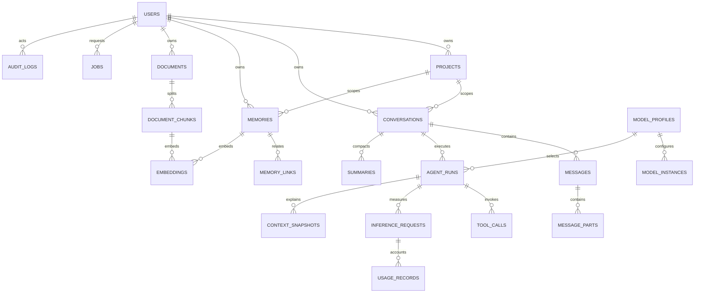

# PostgreSQL Data Model

## Design goals

PostgreSQL is the durable source of truth. Tables preserve ownership and relationships with foreign keys, `CHECK` constraints, and unique indexes so application bugs do not silently create cross-user references or invalid states. Conversation history, curated memory, retrieved candidates, and an individual inference context are separate records with separate lifecycles.

The schema is established by numbered SQL migrations in `apps/api/migrations/`. Phase 2 creates the core relational model. Phase 3 implements conversation/message persistence and selected message lifecycle operations; memory, context, agent orchestration, and inference workflows are still future work.

## Relationship map

## Tables and ownership

| Table | Purpose and key relationships |
| --- | --- |
| `users` | Owner identity placeholder, status, timestamps, soft deletion. Email uniqueness is case-insensitive among active rows. Authentication credentials are deliberately not part of this phase. |
| `projects` | User-owned knowledge scope, with per-owner slug uniqueness and JSON settings. |
| `conversations` | Owner/project scope, archive state, optimistic `version`, message sequence allocator, and optional branch origin. A composite foreign key prevents assigning another user's project. |
| `messages` | Ordered durable records with role, streaming/final state, and assistant reply/generation lineage. Unique `(conversation_id, sequence)` enforces one message per position; a partial unique index permits only one streaming assistant message per conversation. Content is stored in ordered `message_parts` and can be appended while streaming. |
| `message_parts` | Text, reasoning, tool call/result, image reference, or metadata fragment. JSON stores structured tool data; binary assets live outside PostgreSQL and are referenced by storage key. |
| `agent_runs` | One orchestration attempt, its source/response messages, model selection, retry relation, status, and lifecycle timestamps. |
| `tool_calls` | Ordered call arguments/result and status within an agent run. `provider_call_id` is unique within the run when present. Tool authorization remains an application concern. |
| `memories` | Curated user/project/technical/decision/fact/preference/procedure/incident knowledge, confidence, importance, provenance, use counters, and lifecycle. It is not a transcript dump. |
| `memory_links` | Directed, typed support/contradiction/supersession/related/derivation edge between memories owned by the same user. |
| `documents` | User/project document metadata, storage key, checksum, processing state, and byte size. The original file is not stored in this row. |
| `document_chunks` | Ordered text spans with source offsets and estimated token counts. Chunks inherit and enforce their document owner. |
| `embeddings` | One pgvector vector for exactly one memory or document chunk, with model name and checked dimensions. Dimension is recorded per row because the embedding model has not yet been selected. |
| `model_profiles` | Model/provider capability, context/output limits, tokenizer, embedding dimension where applicable, and non-secret configuration. Phase 2 profiles are platform-level. |
| `model_instances` | A concrete endpoint instance for a model profile, health state, and secret reference. Credentials are not stored here. Endpoint authorization/SSRF controls remain required. |
| `inference_requests` | Request correlation, provider/model snapshot, context window, estimates versus provider-reported tokens, phase latencies, disconnect/cache state, and terminal outcome. |
| `usage_records` | Append-oriented token or cost measures with an explicit source, so estimates are not confused with provider-reported values. |
| `context_snapshots` | Token budget breakdown and an item manifest explaining selected context. The manifest must contain references/reasons, not a second copy of prompt text. A check prevents estimated input plus output reserve from exceeding the window. |
| `summaries` | Versioned conversation/branch/problem/incident summaries through a specific message sequence and optional model profile. |
| `jobs` | Durable application-side job tracking and idempotency metadata. BullMQ/Redis remains the future delivery mechanism; this table alone does not implement queue semantics. |
| `audit_logs` | Actor, action, resource, request ID, source IP, and metadata. Append-only behavior must be reinforced with database grants in the security phase. |

## Keys, constraints, and deletion

All primary keys are UUIDs generated by PostgreSQL. UUIDs are useful as opaque cross-module references and can be allocated before an insert, but they are not authorization tokens and random UUIDs produce larger, less sequential B-tree entries than integer keys. Message ordering uses a per-conversation `bigint` sequence, which is the pagination and branch boundary.

The database repeats `owner_user_id` on selected child rows so composite foreign keys can prove that the parent belongs to the same owner. This denormalization is purposeful: a query bug cannot attach a conversation to another user's project, or a memory to another user's source message. Queries must still scope by owner; a foreign key is not authorization.

Users, projects, conversations, memories, documents, and model records use `deleted_at` where hiding/retiring a record is useful. Active uniqueness uses partial indexes where reuse is allowed. Hard deletion is restricted or cascades only for dependent child records; retention and account-erasure policy still need explicit design. Messages and audit records are not soft-deleted in this baseline.

Mutable entities with `updated_at` use a database trigger, so timestamps reflect database writes. All stored timestamps use `timestamptz` and default to database time. JSONB is limited to genuinely variable settings, metadata, and structured tool payloads; fields needed for ownership, joins, filtering, or ordering remain typed columns.

## Open design boundaries

- User accounts exist as an ownership root; Phase 19 must add authentication, authorization, and tenant policy before exposing data beyond loopback.
- Model profiles are global in this initial schema. User-specific model settings require an explicit owner/scope extension and composite constraints.
- `embedding` uses an unbounded-dimension `vector` column with a per-row dimension check. No ANN index is created until an embedding model, dimension, metric, and representative query corpus are selected. Exact vector scans are not a production retrieval plan.
- A `project_id IS NULL` value means user-level scope. Retrieval policy must deliberately combine global user memory with project-specific memory.
- Status checks constrain persisted values but do not implement state transitions. Application services must enforce allowed transitions and compare-and-set/version rules.

## Interview prompts

- Which invariant belongs in a database constraint even if the service already validates it?
- Why duplicate `owner_user_id` on child rows when the owner can be found by joining the parent?
- What is the difference between a conversation's logical history and one context snapshot sent to a model?
- Why are vector embeddings separated from memory/document content, and why do they carry their own dimension and model metadata?
- What does a soft delete preserve, and how can partial uniqueness affect identifier reuse?
- Which JSONB fields should become typed columns when access patterns mature?
