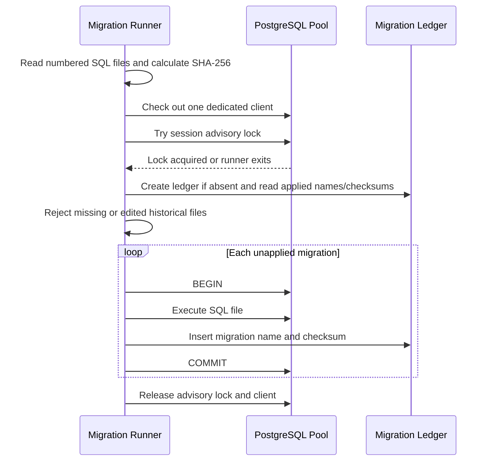

# SQL Migrations with `pg`

## Why a migration runner exists

The PostgreSQL schema is durable shared state. Applying DDL manually makes environments drift; applying schema changes at API startup couples application availability to a potentially destructive action. The platform therefore stores ordered SQL migrations in `apps/api/migrations/` and applies them as an explicit deploy step.

The runner is intentionally small so its behavior is inspectable. It owns migration discovery, advisory locking, integrity checks, transaction boundaries, ledger writes, and process exit status. It does not try to generate SQL or infer whether a migration is safe for live traffic.

## Execution flow

The lock is nonblocking: a second deploy exits instead of waiting indefinitely behind a stuck runner. The same checked-out client holds the session lock and runs each transaction. Every migration and its ledger row commit together. A failure rolls back that migration; prior migrations remain applied and recorded.

## Integrity and ordering

File names use `NNNN_description.sql` with a unique numeric prefix. The runner sorts names lexically, computes SHA-256 from the exact file bytes, and stores it in `_platform_schema_migrations`. On later runs it fails if an applied file disappears or its checksum changes. This discourages rewriting history; add a new forward migration instead.

The current migration enables the `vector` extension. The extension already existed from the prior baseline, so `CREATE EXTENSION IF NOT EXISTS vector` safely established the new runner's ledger without dropping database state.

## Transaction and recovery limits

The runner wraps each SQL file in one PostgreSQL transaction. This gives an atomic commit between migration DDL and the ledger insert for transaction-safe commands. Do not put `CREATE INDEX CONCURRENTLY`, commands that cannot run in a transaction, or very long online data rewrites in this format. Before such a migration is needed, add an explicit nontransactional mode with well-defined crash recovery and test it against production-like data.

If execution fails, inspect the migration file, PostgreSQL error code, current schema, and ledger before retrying. The runner will retry an unapplied migration on the next invocation after rollback. It will not automatically repair a partially applied nontransactional operation or alter a checksum. Never delete ledger rows to force a migration through without a reviewed recovery plan.

## Scaling, security, and observability

The advisory lock serializes one database's migration runs across deploy processes. It does not coordinate changes across separate databases, and every environment needs its own reviewed migration state. DDL can still block application queries even while the runner is correctly serialized; deploy-safe expand/contract changes and lock budgets belong to the migration author.

Migrations run with the configured database role, so production should use a dedicated role with only required DDL permissions during deploy, separate from the API runtime role. SQL files are privileged code and must be reviewed. Query values in runtime repositories use bind parameters; migration files are static and must never interpolate untrusted input.

The runner logs applied/skipped migration names and exits nonzero on failure without logging connection strings or raw database errors. Future observability should add elapsed time, PostgreSQL error code classification, and deploy correlation IDs. Never put SQL bind values or secrets in migration logs.

## Interview prompts

- Why must a transaction use one checked-out pool client for `BEGIN` through `COMMIT`?
- What problem does an advisory lock solve, and what happens if the lock holder crashes?
- Why are both a migration ledger and checksums useful?
- Why does `CREATE INDEX CONCURRENTLY` need a different migration mode?
- How do you evolve a schema safely while old and new API versions overlap?
- Why should migrations use a different database role from normal API queries?
